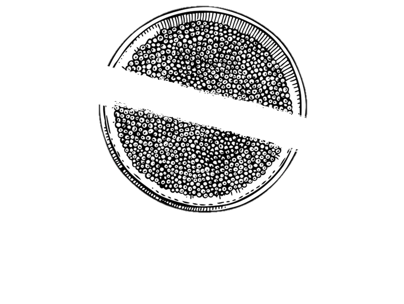
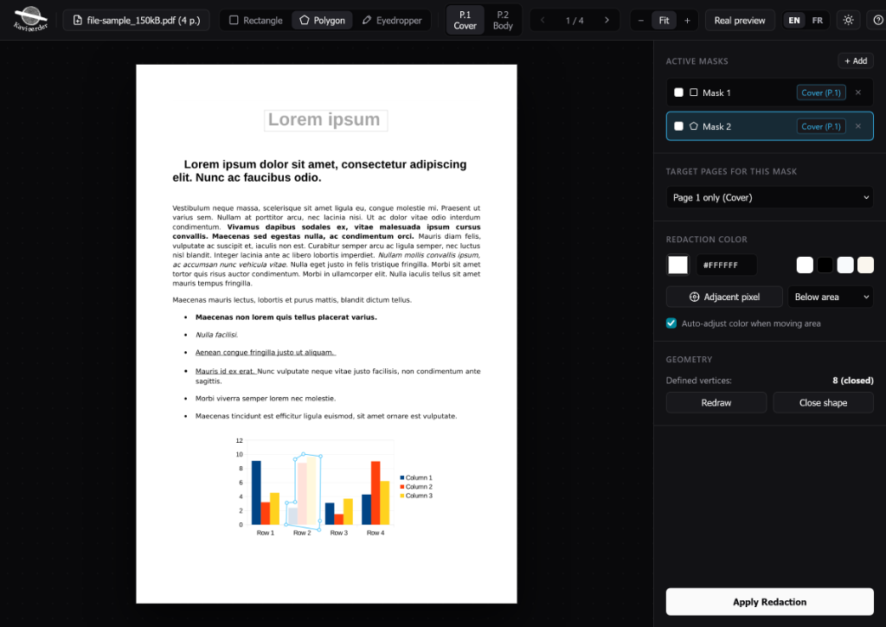
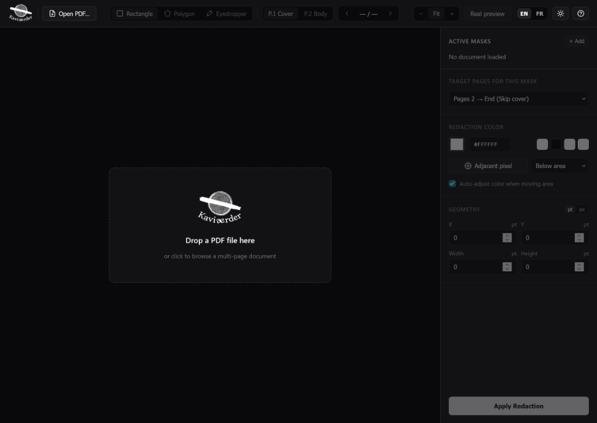

<p align="center">
  
</p>

<h1 align="center">Kaviaarder</h1>

<p align="center">
  A local web tool to visually redact headers, text, or arbitrary areas across multiple PDF pages.
</p>

<p align="center">
  
</p>

---

## What it does

Kaviaarder is a local web app designed to mask repeating elements (headers, footers, logos, signatures) or sensitive sections across multi-page PDFs.

- **Destructive redaction**: Uses PyMuPDF's `apply_redactions()` to permanently remove underlying text, vector paths, and image pixels from the file structure, rather than just drawing a cosmetic rectangle over them.
- **Rectangles & polygons**: Draw regular rectangular masks or custom multi-vertex polygons to cover irregular shapes.
- **Page rules**: Apply a mask to all pages, skip the cover page (pages 2 to end), target only the cover, or define custom page ranges (e.g. `2-10, 15`).
- **Multiple masks**: Add multiple independent masks per document with their own page rules and shapes.
- **Background matching**: Auto-detects the background color by sampling pixels immediately outside the selection area.
- **Real preview**: Runs PyMuPDF on the current page in memory to confirm visual results and check the exact character count removed before exporting.
- **100% local**: Runs locally via FastAPI. Files never leave your machine.
- **Light / Dark mode & EN / FR**: Includes a dark/light theme switch and an English/French toggle.

<details>
  <summary>View drop state screenshot</summary>
  <br/>
  <p align="center">
    
  </p>
</details>

---

## Quickstart

### Requirements

- Python 3.10+
- A modern browser

### Quick Launch (Zero Config)

- **Windows**: Double-click `run.bat`
- **Linux / macOS**: Run `./run.sh`

*(The script automatically creates the virtual environment, installs dependencies on first run, and launches the application in your browser).*

### Manual Setup

```bash
# Clone the repository
git clone https://github.com/aent0n/kaviaarder.git
cd kaviaarder

# Create & activate virtual environment
python -m venv .venv
# On Windows: .\.venv\Scripts\Activate.ps1
# On Linux/macOS: source .venv/bin/activate

# Install dependencies and start
pip install -r requirements.txt
python app.py
```

#### Optional flags

```bash
python app.py --port 8080      # Custom port
python app.py --host 0.0.0.0   # Allow local network access
python app.py --no-browser     # Don't auto-open browser
python app.py --reload         # Live code reload
```

---

## Keyboard shortcuts

| Key | Action |
| :--- | :--- |
| <kbd>R</kbd> | Rectangle tool |
| <kbd>P</kbd> | Polygon tool |
| <kbd>I</kbd> | Eyedropper / color picker |
| <kbd>Enter</kbd> | Close ongoing polygon |
| <kbd>Delete</kbd> / <kbd>Backspace</kbd> | Remove active mask |
| <kbd>1</kbd> / <kbd>2</kbd> | Jump to Cover (P.1) / Body (P.2) |
| <kbd>[</kbd> / <kbd>]</kbd> or <kbd>←</kbd> / <kbd>→</kbd> | Previous / next page |
| <kbd>0</kbd> | Fit page to window |
| <kbd>+</kbd> / <kbd>-</kbd> | Zoom in / out |
| <kbd>Esc</kbd> | Cancel last vertex / close dialogs |
| <kbd>?</kbd> | Open shortcuts cheat sheet |

---

## License

[PolyForm Noncommercial 1.0.0](LICENSE)

Free for personal, academic, and noncommercial use. Commercial use, paid services, redistribution for monetary compensation, or making profit from this software is strictly prohibited.

---

Created by [aent0n](https://github.com/aent0n).
